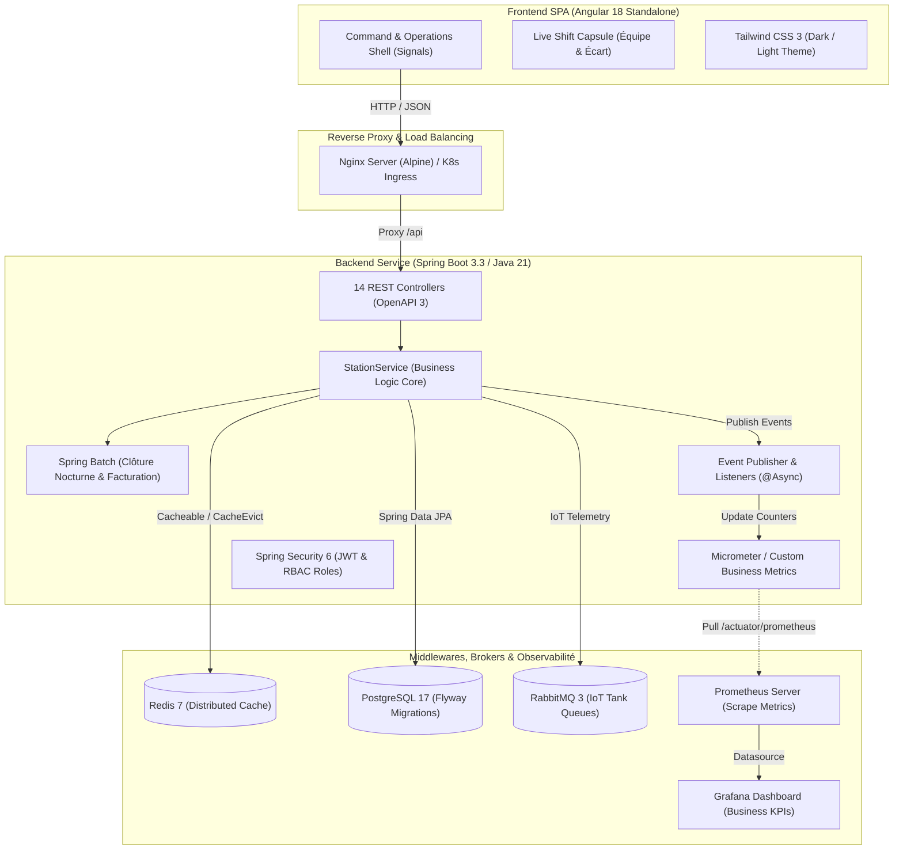

# ⛽ PETROFLOW 360 - Enterprise Multi-Network Station-Service OS & ERP

[](https://github.com/sirinedaik55/station-service/actions)


> **Plateforme d'entreprise de gestion opérationnelle, financière et logistique pour réseaux de stations-service multi-marques.**  
> Conçue selon les standards d'ingénierie logicielle Senior : **Interface "Command & Operations Shell" haute densité (sans templates IA génériques), Tableau de bord décisionnel temps réel, API REST OpenAPI 3, Cache Redis résilient, Architecture événementielle asynchrone RabbitMQ (télémétrie IoT cuves), Job de nuit Spring Batch, Observabilité Prometheus/Grafana, Qualité de code SonarQube / JaCoCo, et Déploiement automatisé Docker & Kubernetes.**

---

## 🏛️ Architecture Technique & Écosystème



---

## ✨ Points Clés & Règles Métier Avancées

### 1. 💰 Feuille de Quart & Clôture Shift Multi-Règlements
- Gestion des **3 shifts quotidiens** (*Matin, Soir, Nuit*) et traçabilité des chefs d'équipe.
- Rapprochement multi-modes d'encaissement en temps réel :
  - **Espèces physiques** en caisse.
  - **Bons Carburant & Vouchers Flotte B2B** (papier & digital).
  - **Cartes Pétrolières Privées & Cartes Bancaires** (terminaux TPE).
  - **Chèques bancaires clients**.
  - **Bons Crédits B2B** (entreprises en compte).
  - **Déduction des menues dépenses d'exploitation piste**.
- Calcul dynamique en direct de l'**écart de caisse** (Surplus / Manquant) :
  $$\text{Écart} = \text{Total Encaissé Réel} - \text{Total Théorique (Piste + Kiosque + Lavage)}$$

### 2. 📏 Téléjaugeage Physique & Coulage Admissible
- Contrôle quotidien à la **règle pige (cm)** et conversion en **volume physique (L)** selon le barème d'étalonnage.
- Calcul automatique du **coulage thermique / évaporatoire** ($\text{Physique} - \text{Théorique}$).
- Déclenchement automatique d'alertes en cas de coulage critique pour prévenir les risques de fuites environnementales ou de vol.

### 3. ⚡ Cache Distribué Redis Résilient
- `@Cacheable("produits")` : Mise en cache du barème des prix de carburants et catalogue lubrifiants.
- `@Cacheable("cuves")` : Accès ultra-rapide aux niveaux volumétriques des citernes.
- `@CacheEvict` : Invalidation intelligente du cache lors des dépotages, ventes ou jaugeages.
- Mode résilient : bascule automatique en cache mémoire simple (`ConcurrentMapCache`) si Redis n'est pas actif localement.

### 4. 📡 Architecture Événementielle & Télémétrie IoT Asynchrone (RabbitMQ)
- `AlerteStockCuveEvent` : Déclenché dès qu'un niveau de cuve passe sous son seuil d'alerte ou en cas de coulage anormal.
- `ClotureShiftEvent` : Journalisation d'audit financier et publication asynchrone des écarts de caisse.
- Simulateur IoT intégré publiant périodiquement des variations volumétriques sur la file `station.telemetrie.cuves`.

### 5. 🌙 Spring Batch — Clôture Nocturne & Facturation Automatique
- Consolidation automatique des 3 shifts de la journée à 23h59.
- Regroupement des bons flottes non facturés par client B2B.
- Application légale du **Timbre Fiscal obligatoire (1.000 DT)** : $\text{Total TTC} = \text{Total HT} + \text{1.000 DT}$.
- Génération récapitulative et mise à jour des soldes de crédit.

### 6. 📊 Observabilité & Métriques Métier Prometheus / Grafana
- Exposition des métriques via **Spring Boot Actuator** & **Micrometer** sur `/actuator/prometheus` :
  - `station.ventes.litres.total` : Compteur de carburant total distribué à la pompe.
  - `station.ca.recettes.total` : Chiffre d'affaires cumulé en Dinars Tunisiens (DT).
  - `station.alertes.cuves.total` : Nombre total d'alertes de stock critique.
  - `station.shifts.ecarts.total` : Nombre de shifts présentant des anomalies financières.

---

## 🚀 Démarrage Rapide (En 1 Commande)

Le projet intègre un orchestrateur **Docker Compose** prêt pour la production.

### Prérequis
- [Docker Desktop](https://www.docker.com/) ou Docker Engine & Docker Compose

### Lancement de l'écosystème complet
```bash
# Cloner le projet
git clone https://github.com/sirinedaik55/station-service.git
cd station-service

# Lancer PostgreSQL 17, Redis 7, RabbitMQ, Spring Boot API, Angular Frontend, Prometheus et Grafana
docker compose up --build -d
```

### URLs d'Accès aux Services
| Service | URL | Identifiants par défaut | Description |
|---|---|---|---|
| **Portail Web Angular** | `http://localhost` | - | Interface tactile "Command & Operations Shell" |
| **Documentation OpenAPI** | `http://localhost:8080/swagger-ui.html` | - | Interface interactive Swagger UI (14 contrôleurs) |
| **Dashboard Grafana** | `http://localhost:3000` | `admin` / `admin` | Superviseur KPIs métier & JVM préconfiguré |
| **Console RabbitMQ** | `http://localhost:15672` | `guest` / `guest` | Monitoring des files de télémétrie IoT |
| **Monitoring Prometheus** | `http://localhost:9090` | - | Dashboard et métriques de scraping |
| **Actuator Metrics** | `http://localhost:8080/actuator/prometheus` | - | Endpoint de collecte Prometheus |
| **Authentification JWT** | `POST /api/v1/auth/login` | `gerant` / `gerant123` | Émission de tokens avec rôles (Gérant, Pompiste, Comptable) |
| **Batch Facturation** | `POST /api/v1/batch/declencher-facturation-nocturne` | - | Déclenchement manuel du job Spring Batch |

---

## ☸️ Déploiement Kubernetes (K8s)

Des manifestes Kubernetes prêts pour la production sont fournis dans le dossier [`k8s/`](k8s/) :

```bash
# Déploiement dans le namespace station-system
kubectl apply -f k8s/00-namespace.yaml
kubectl apply -f k8s/01-configmap-secrets.yaml
kubectl apply -f k8s/02-postgres.yaml
kubectl apply -f k8s/03-redis.yaml
kubectl apply -f k8s/04-rabbitmq.yaml
kubectl apply -f k8s/05-backend.yaml
kubectl apply -f k8s/06-frontend.yaml
kubectl apply -f k8s/07-ingress.yaml

# Vérification du cluster
kubectl get all -n station-system
```

---

## 🔄 CI/CD Automation (Jenkins & GitHub Actions)

- **Jenkins Declarative Pipeline :** Fichier [`Jenkinsfile`](Jenkinsfile) en 7 étapes :
  `Checkout` ➔ `Build & Unit Tests` ➔ `Code Coverage (JaCoCo)` ➔ `SonarQube Quality Gate` ➔ `Docker Images Build` ➔ `Security Scan` ➔ `Deploy to Staging/K8s`.
- **GitHub Actions :** Workflow automatisé sous [`.github/workflows/ci.yml`](.github/workflows/ci.yml).

---

## 🛠️ Stack Technologique Détaillé

### Backend
- **Framework :** Spring Boot 3.3 / Java 21 (LTS)
- **Persistence :** Spring Data JPA, Hibernate, PostgreSQL 17
- **Base de données Versionnée :** Flyway (Migrations V1, V2, V3)
- **Documentation API :** Springdoc OpenAPI 3.0 / Swagger UI
- **Cache :** Spring Data Redis, Jedis/Lettuce, Redis 7 Alpine
- **Sécurité :** Spring Security 6 (JWT & RBAC : `ROLE_GERANT`, `ROLE_POMPISTE`, `ROLE_COMPTABLE`)
- **Messaging :** Spring AMQP / RabbitMQ 3
- **Batch :** Spring Batch 5 (Traitement par chunk)
- **Observabilité :** Spring Boot Actuator, Micrometer Registry Prometheus
- **Qualité & Tests :** JUnit 5, Mockito, AssertJ, Testcontainers PostgreSQL 17, JaCoCo

### Frontend
- **Framework :** Angular 18 (Standalone Components, Signals réactifs)
- **Design System :** Tailwind CSS 3, Command & Operations Shell, Icons SVG au trait, Dark/Light Mode
- **Serveur Web :** Nginx Alpine optimisé avec fallback SPA

### DevOps & Cloud
- **Conteneurisation :** Dockerfiles multi-stage builds (séparation build/runtime pour images ultra-légères)
- **Orchestration locale :** Docker Compose avec healthchecks et volumes persistants
- **Orchestration Cloud :** Kubernetes (Deployments, Services ClusterIP, Ingress NGINX, PersistentVolumeClaims)
- **Qualité Continue :** SonarQube Scanner, JaCoCo Coverage

---

## 📁 Structure du Projet

```text
station-service/
├── .github/
│   └── workflows/
│       └── ci.yml                # Pipeline CI/CD GitHub Actions automatisé
├── Jenkinsfile                   # Pipeline déclaratif CI/CD Jenkins (7 stages)
├── k8s/                          # 8 Manifestes Kubernetes (Namespace, Ingress, Deployments)
│   ├── 00-namespace.yaml
│   ├── 01-configmap-secrets.yaml
│   ├── 02-postgres.yaml
│   ├── 03-redis.yaml
│   ├── 04-rabbitmq.yaml
│   ├── 05-backend.yaml
│   ├── 06-frontend.yaml
│   └── 07-ingress.yaml
├── backend/
│   ├── Dockerfile                # Multi-stage Dockerfile (Temurin 21)
│   ├── pom.xml                   # Configuration Maven, JaCoCo & SonarQube
│   └── src/
│       ├── main/java/com/station/api/
│       │   ├── batch/            # Configuration Spring Batch
│       │   ├── config/           # OpenAPI, Security, Cache Redis, RabbitMQ
│       │   ├── controller/       # 14 Contrôleurs REST documentés OpenAPI 3
│       │   ├── event/            # Architecture événementielle (@Async)
│       │   ├── model/            # Entités JPA (Citernes, Pistolets, Shifts...)
│       │   ├── repository/       # Interfaces Spring Data JPA
│       │   ├── security/         # Filtre JWT, UserDetailsService, Auth Controller
│       │   └── service/          # Logique métier, Cache Redis, IoT Simulator
│       └── test/                 # Tests unitaires JUnit 5, Mockito & Testcontainers
├── frontend/
│   ├── Dockerfile                # Multi-stage Dockerfile (Nginx Alpine)
│   ├── nginx.conf                # Configuration Nginx SPA fallback
│   └── src/
│       ├── app/                  # Composants Angular 18 Standalone & Signals
│       └── styles.scss           # Design system épuré & Tailwind
├── grafana/                      # Provisioning des dashboards Grafana
├── docker-compose.yml            # Orchestration complète 7 services
├── prometheus.yml                # Configuration de scraping Prometheus
├── .gitignore                    # Exclusion node_modules, target, logs, secrets
└── README.md                     # Documentation complète du projet
```

---

## 💼 Mention sur CV & LinkedIn (Pour Recruteurs)

```text
Projet : PETROFLOW 360 - Plateforme ERP & OS Multi-Réseaux pour Stations-Service
Stack : Spring Boot 3.3, Angular 18, Java 21, PostgreSQL 17, Redis, RabbitMQ, Docker, Kubernetes, Jenkins, SonarQube.
Réalisations Clés :
- Développement de l'API REST Core sous Spring Boot 3 et Java 21 (14 contrôleurs documentés OpenAPI 3).
- Implémentation du rapprochement multi-modes de règlements (Espèces, Bons B2B, TPE, Chèques) et téléjaugeage physique avec coulage admissible.
- Architecture événementielle asynchrone (RabbitMQ) pour la télémétrie IoT des sondes de cuves et alertes critiques.
- Job nocturne Spring Batch de réconciliation comptable et facturation groupée B2B avec timbre fiscal légal (1.000 DT).
- Stratégie de cache distribué Redis avec invalidation intelligente (@Cacheable, @CacheEvict).
- Interface opérateur Angular 18 Standalone réactive avec Tailwind CSS et ruban opérationnel de shift en direct.
- Observabilité complète (Micrometer, Prometheus, dashboards Grafana personnalisés).
- Pipeline CI/CD Jenkins & GitHub Actions avec couverture de code JaCoCo et Quality Gate SonarQube.
- Conteneurisation Docker multi-stage et manifestes de déploiement Kubernetes (K8s).
```

---

## 📄 Licence
Distribué sous licence **Apache 2.0**. Développé pour la modernisation et la digitalisation de la gestion des stations-service.
